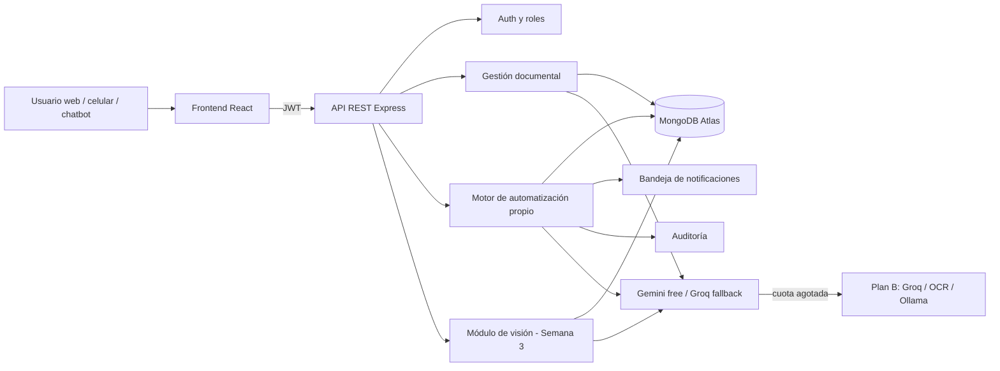

# Tercer corte — Semana 1: inventario, ruta y arquitectura

**Asignatura:** Desarrollo de Aplicaciones Empresariales
**Programa:** Tecnología en Desarrollo de Sistemas Informáticos
**Proyecto:** Sistema Inteligente de Gestión y Análisis Documental con IA
**Integrante:** Emmanuel Pinto Plata
**Fecha:** noviembre de 2026

---

## 1. Contexto y alcance

En los dos cortes anteriores el aplicativo ya permitía autenticarse, gestionar
repositorios y documentos, procesar archivos con IA, consultar el contenido con
un chatbot RAG y notificar el resultado del procesamiento mediante un flujo de
n8n.

Para el tercer corte se reemplaza la dependencia de n8n en la nube por un
**motor de automatización propio en código** y se agrega un **módulo de visión
por computador** para un proceso real de la empresa. En esta semana se define el
inventario, la ruta de reemplazo, el caso de visión y la arquitectura.

---

## 2. Inventario de flujos de n8n

El repositorio contiene una integración con n8n en
`backend/src/services/webhookService.js`. El flujo se dispara al terminar el
procesamiento de un documento y envía un payload al webhook
`documento-procesado`.

| ID | Flujo | Disparador | Pasos identificados | Servicios externos | Entrada | Resultado |
|---|---|---|---|---|---|---|
| F1 | Documento procesado (éxito) | Evento interno `document.processed` al completar el pipeline de IA | 1) Leer documento y usuario en MongoDB. 2) Construir payload. 3) POST al webhook con `x-api-key`. 4) Notificar al usuario/registrar el resultado. | n8n Cloud, MongoDB | `userId`, `userEmail`, `fileName`, `status`, `category`, `summary`, `errorMessage` | Notificación del documento procesado y registro de la ejecución |
| F1-E | Documento con error | Evento interno `document.processing_failed` cuando el pipeline falla | 1) Leer documento y usuario. 2) Construir payload con `status=error` y `errorMessage`. 3) POST al webhook. 4) Alertar al usuario. | n8n Cloud, MongoDB | Igual que F1, con `status=error` | Alerta de error y registro de la ejecución |

> **Suposición documentada:** el código solo permite ver el payload que se envía
> a n8n; no se conserva el export del workflow. Por eso F1 y F1-E se reconstruyen
> a partir de los campos enviados y de las dos ramas que produce el sistema. Si
> el docente solicita el detalle exacto de los nodos, se anexará el export de
> n8n cuando esté disponible.

### 2.1 Contrato de entrada del flujo actual

```json
{
  "userId": "string",
  "userEmail": "string",
  "fileName": "string",
  "status": "completed | error",
  "category": "Contrato | Factura | Reporte | Otro",
  "summary": "string",
  "errorMessage": "string"
}
```

### 2.2 Problemas del flujo actual

- Depende de n8n en la nube y de una URL externa.
- Si el webhook falla, solo se escribe un `console.warn`; no hay reintentos ni
  registro persistente de la ejecución.
- No existe una bandeja interna de notificaciones para el usuario.
- La clave del webhook tiene un valor por defecto en el código.

---

## 3. Ruta de reemplazo elegida: Ruta A (código propio)

Se elige la **Ruta A** porque:

1. El backend ya está construido en Node.js/Express y Mongoose.
2. Permite reutilizar autenticación, roles y acceso a MongoDB.
3. Evita instalar y administrar un servidor n8n adicional.
4. Facilita el registro de ejecuciones, los reintentos y las pruebas unitarias.
5. Deja el sistema desplegado en Render sin depender de una plataforma externa.

### 3.1 Equivalencia n8n → código propio

| n8n | Reemplazo en código |
|---|---|
| Webhook `documento-procesado` | Evento interno `document.processed` |
| Rama de error del flujo | Evento interno `document.processing_failed` |
| Nodo HTTP / notificación | `notificationService` + colección `notifications` |
| Ejecuciones del workflow | Colección `automationruns` con estado, intentos y tiempos |
| Credenciales del webhook | Variables de entorno (`GEMINI_API_KEY`, `GROQ_API_KEY`, etc.) |

---

## 4. Caso de visión: lectura de facturas y recibos

### 4.1 Proceso de negocio

El sistema recibe la foto o el PDF de una factura o recibo, extrae los datos
principales y crea un registro en el módulo de compras/gastos. Si la confianza
es baja, el usuario revisa y confirma antes de guardar.

### 4.2 Entrada y salida

**Entrada:** imagen (`JPG`, `PNG`) o PDF de una factura o recibo.

**Salida estructurada:**

```json
{
  "proveedor": "string",
  "nit": "string",
  "fecha": "YYYY-MM-DD",
  "numero_factura": "string",
  "items": [
    { "descripcion": "string", "cantidad": 1, "valor_unitario": 0 }
  ],
  "subtotal": 0,
  "impuestos": 0,
  "total": 0,
  "confianza": 0.0,
  "campos_baja_confianza": ["string"]
}
```

### 4.3 Decisión que toma el sistema

- Si `confianza >= 0.85`: guarda el gasto y dispara la automatización
  `factura.registrada`.
- Si `confianza < 0.85`: muestra los datos al usuario para confirmación antes de
  guardar.
- Si la imagen no es legible: registra el intento y devuelve un error claro.

### 4.4 Tecnología prevista

- **Semana 3:** Gemini multimodal (nivel gratuito) para facturas y documentos.
- **Plan B:** OCR de código abierto (Tesseract o PaddleOCR) + modelo de lenguaje
  para estructurar el texto.
- **Semana 4:** integración con el motor de automatización y pruebas con 20
  imágenes reales.

---

## 5. Arquitectura propuesta



### 5.1 Componentes

| Componente | Responsabilidad |
|---|---|
| Frontend React | Carga de documentos, chat RAG, notificaciones y revisión de facturas. |
| API Express | Autenticación, permisos por rol, endpoints de documentos, búsqueda y automatización. |
| Motor de automatización | Registro de flujos, ejecución por evento, reintentos, timeout y logs. |
| Módulo de visión | Recibe imágenes, extrae datos de facturas y devuelve JSON con confianza. |
| Gemini / Groq | Modelos gratuitos para chat, clasificación, resumen, embeddings y visión. |
| MongoDB Atlas | Documentos, fragmentos, ejecuciones, notificaciones y auditoría. |
| Plan B | Groq para chat, OCR local y búsqueda por palabras clave si falla la IA. |

---

## 6. Plan de la Semana 2

1. Crear el modelo de datos del motor: `AutomationFlow`, `AutomationRun`,
   `Notification` y `AuditLog`.
2. Implementar `automationService` con registro de flujos, ejecución por evento,
   reintentos, timeout, idempotencia y registro de cada intento.
3. Migrar F1 y F1-E al motor interno y retirar la dependencia de n8n en la nube.
4. Agregar endpoints para consultar ejecuciones y notificaciones.
5. Migrar las llamadas de IA a Gemini free, con Groq como respaldo para chat.
6. Adaptar el chatbot RAG al nuevo proveedor sin cambiar su comportamiento.
7. Agregar plan B de búsqueda por palabras clave si fallan los embeddings.
8. Escribir pruebas unitarias de los flujos y evidencia para la revisión.

---

## 7. Riesgos y plan B

| Riesgo | Impacto | Mitigación |
|---|---|---|
| Se agota la cuota gratuita de Gemini | El chat o los embeddings fallan | Groq para chat; búsqueda por palabras clave y OCR local como respaldo. |
| Gemini no responde o tarda demasiado | El procesamiento se bloquea | Timeout, reintentos y cambio automático a Groq. |
| Los embeddings cambian de dimensión | El índice vectorial de Atlas deja de servir | Reindexación con script y dimensión configurable por variable de entorno. |
| El servidor gratuito no soporta Ollama | No hay modelo local en producción | Ollama solo como plan B local; producción usa Gemini/Groq. |
| Datos personales en facturas | Riesgo de privacidad | Anonimizar antes de enviar a la nube o usar OCR local; acceso por rol y auditoría. |

---

## 8. Criterios de aceptación de la Semana 1

- [x] Inventario de los flujos n8n documentado.
- [x] Ruta de reemplazo elegida y justificada.
- [x] Caso de uso de visión definido con entrada, salida y decisión.
- [x] Diagrama de arquitectura propuesto.
- [x] Riesgos y plan B identificados.
- [x] Plan de implementación de la Semana 2.
