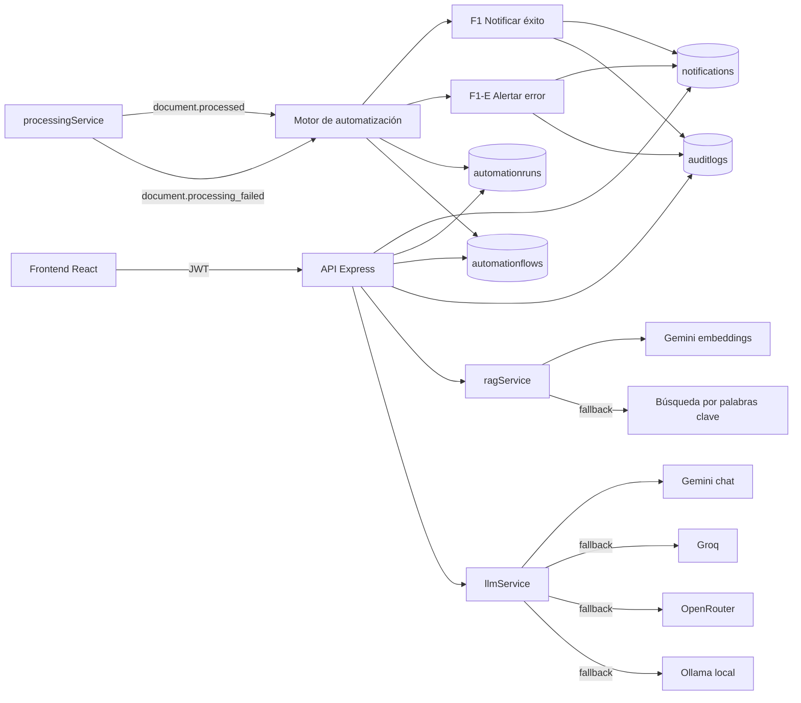

# Semana 2 — Motor de automatización propio y chatbot con IA gratuita

**Asignatura:** Desarrollo de Aplicaciones Empresariales
**Programa:** Tecnología en Desarrollo de Sistemas Informáticos
**Proyecto:** Sistema Inteligente de Gestión y Análisis Documental con IA
**Integrante:** Emmanuel Pinto Plata
**Fecha:** noviembre de 2026

---

## 1. Objetivo y alcance

En la Semana 1 se definieron el inventario de n8n, la Ruta A (código propio),
el caso de visión y la arquitectura. En la Semana 2 se implementó:

1. Un motor de automatización propio en Node.js/Express.
2. Los dos flujos que antes vivían en n8n (F1 y F1-E).
3. Logs por ejecución, reintentos, timeout, idempotencia y auditoría.
4. La migración de la IA a proveedores gratuitos (Gemini + Groq de respaldo).
5. Una bandeja interna de notificaciones que reemplaza el resultado del flujo
   externo.
6. Pruebas unitarias y evidencia de ejecución.

El sistema deja de depender de n8n en la nube. La automatización ahora vive en
el código y se ejecuta dentro del backend desplegado en Render.

---

## 2. Resultado de la semana

| Requisito de la guía | Estado | Evidencia |
|---|---|---|
| Motor de automatización propio | Cumplido | `backend/src/automation/engine.js` |
| Al menos la mitad de los flujos de n8n migrados | Cumplido (2 de 2) | `documentProcessedFlow`, `documentFailedFlow` |
| Reintentos ante errores | Cumplido | `maxRetries`, `retryDelayMs`, pruebas de reintento |
| Timeout por ejecución | Cumplido | `withTimeout`, `timeoutMs` por flujo |
| Log por ejecución con fecha, entrada y resultado | Cumplido | Colección `automationruns` (`logs`, `input`, `output`) |
| Claves en variables de entorno | Cumplido | `backend/.env.example`, sin claves en el código |
| Chatbot migrado a modelo gratuito | Implementado; falta prueba con clave Gemini | `llmService.js`, `npm run ai:test` |
| Plan B ante cuota o fallo | Cumplido | Groq/OpenRouter/Ollama y búsqueda por palabras clave |
| Pruebas unitarias | Cumplido | `backend/test/` — 18 pruebas |
| Auditoría de acciones | Cumplido | Colección `auditlogs` + `GET /api/audit` |
| Roles y control de acceso | Cumplido | `protect`, `authorize("admin")` |

---

## 3. Arquitectura implementada



---

## 4. Motor de automatización

### 4.1 Registro de flujos

Los flujos se definen en código (`backend/src/automation/flows/`) y se registran
al arrancar. Después se sincronizan con la colección `automationflows` para
poder consultarlos, ver estadísticas y deshabilitarlos sin borrar código.

Cada flujo declara:

| Campo | Uso |
|---|---|
| `key` | Identificador único (`documento-procesado`, `documento-error`). |
| `event` | Evento que lo dispara (`document.processed`, `document.processing_failed`). |
| `steps` | Pasos documentados para el inventario. |
| `maxRetries` | Reintentos adicionales (por defecto 2 → 3 intentos). |
| `retryDelayMs` | Espera entre intentos, con retroceso lineal. |
| `timeoutMs` | Tiempo máximo por intento. |
| `idempotencyKey(payload)` | Evita duplicar una ejecución completada. |
| `run({ payload, attempt, runId, context, log })` | Lógica del flujo. |

### 4.2 Ciclo de una ejecución

1. Se recibe un evento con `engine.emit(event, payload, context)`.
2. Se buscan los flujos habilitados para ese evento.
3. Antes de ejecutar se revisa:
   - que el flujo no esté deshabilitado en `automationflows`;
   - que no exista una ejecución **completada** con la misma clave de
     idempotencia.
4. Se crea un documento en `automationruns` con estado `running`, entrada,
   intentos y usuario que lo disparó.
5. Se ejecuta el flujo con timeout.
6. Si falla, se registra el error, se pasa a `retrying` y se espera
   `retryDelayMs * intento`.
7. Al terminar, la ejecución queda `completed` o `failed`, con `output`,
   `error`, `finishedAt` y `durationMs`.
8. Se registra una entrada en `auditlogs` con el resultado.

### 4.3 Estados de una ejecución

| Estado | Significado |
|---|---|
| `running` | Ejecutándose. |
| `retrying` | Falló un intento y se espera el siguiente. |
| `completed` | Terminó correctamente. |
| `failed` | Agotó los intentos. |
| `skipped` | No se ejecutó por idempotencia o por estar deshabilitado. |

### 4.4 Garantías del motor

- **Aislamiento:** si un flujo falla, los demás flujos del mismo evento siguen
  ejecutándose (`emit` captura los errores por flujo).
- **Idempotencia:** índice único parcial sobre `idempotencyKey` cuando el estado
  es `completed`.
- **No bloqueo del pipeline:** `processingService` dispara la automatización
  después de guardar el resultado; si el motor falla, el documento conserva su
  estado y la notificación queda registrada para reintento.
- **Trazabilidad:** cada intento agrega una entrada al arreglo `logs` con
  `attempt`, `level`, `message` y `at`.

---

## 5. Flujos migrados desde n8n

### 5.1 F1 — Documento procesado (rama de éxito)

| Aspecto | Antes (n8n) | Ahora (código propio) |
|---|---|---|
| Disparador | Evento interno → POST al webhook | `document.processed` |
| Paso 1 | Construir payload | Leer documento en MongoDB |
| Paso 2 | POST al webhook | Crear notificación interna |
| Paso 3 | Notificar al usuario | Registrar auditoría |
| Resultado | Notificación externa sin log persistente | `notifications` + `automationruns` + `auditlogs` |

**Datos de salida:** `notificationId`, `userId`, `category`, `documentId`.

### 5.2 F1-E — Documento con error

| Aspecto | Antes (n8n) | Ahora (código propio) |
|---|---|---|
| Disparador | POST con `status=error` | `document.processing_failed` |
| Paso 1 | Construir payload con error | Leer documento |
| Paso 2 | POST al webhook | Crear alerta tipo `error` |
| Paso 3 | Alertar al usuario | Registrar auditoría con el error |
| Resultado | Alerta sin reintentos | Alerta con reintentos y evidencia |

**Datos de salida:** `notificationId`, `userId`, `errorMessage`, `documentId`.

> **Inventario:** el detalle completo y la suposición documentada están en
> `Semana 1 - Diseño/Documento de arquitectura - Semana 1.md`. No se conserva el
> export de n8n; el inventario se reconstruyó desde el código.

---

## 6. Migración de la IA a proveedores gratuitos

### 6.1 Orden de proveedores de chat

Con `AI_PROVIDER=auto` el orden es:

1. **Gemini** (`gemini-3.5-flash-lite` por defecto).
2. **Groq** (`openai/gpt-oss-120b`).
3. **OpenRouter/OpenAI** (compatibilidad con el proveedor anterior).
4. **Ollama** local (solo si `OLLAMA_ENABLED=true`).

Solo se incluyen los proveedores que tengan clave o estén habilitados. La cadena
de respaldo se implementa con LangChain:

```js
models[0].withFallbacks(models.slice(1))
```

Si Gemini agota la cuota, responde con error o supera el timeout, LangChain
prueba automáticamente el siguiente proveedor configurado.

### 6.2 Modelos y vigencia

| Proveedor | Modelo por defecto | Uso |
|---|---|---|
| Gemini | `gemini-3.5-flash-lite` | Chat, clasificación, resumen, extracción y visión (Semana 3). |
| Gemini | `gemini-embedding-001` (1536 dimensiones en este proyecto) | Embeddings para RAG. |
| Groq | `openai/gpt-oss-120b` | Respaldo de chat. |
| OpenRouter | `deepseek/deepseek-chat` | Compatibilidad con el proveedor anterior. |
| Ollama | `llama3.2` / `nomic-embed-text` | Plan B local, sin cuotas. |

> Se actualizaron los modelos porque `gemini-2.0-flash` fue retirado el
> 1 de junio de 2026 y `text-embedding-004` el 14 de enero de 2026. Los nombres
> son configurables desde `.env` para no depender del código si cambian.

### 6.3 Embeddings con dimensión fija

El endpoint compatible con OpenAI de Gemini puede devolver 3072 dimensiones por
defecto. Para que el índice de Atlas no quede inconsistente, el sistema usa el
**endpoint nativo** `models/gemini-embedding-001:batchEmbedContents` y envía
`outputDimensionality: 768`.

Regla del sistema: **nunca se mezclan dimensiones**.

| Proveedor | Dimensiones |
|---|---|
| Gemini `gemini-embedding-001` | 768 |
| Ollama `nomic-embed-text` | 768 |
| OpenRouter `text-embedding-3-small` | 1536 |

Si el proveedor principal falla, solo se prueba otro proveedor con la **misma**
dimensión. Si no hay ninguno, se usa la búsqueda por palabras clave.

### 6.4 Plan B de recuperación (RAG)

`ragService.semanticSearch` intenta primero la búsqueda vectorial. Si falla el
índice, el proveedor de embeddings o la cuota, usa:

1. Búsqueda de texto de MongoDB (`$text`).
2. Expresión regular sobre nombre, resumen y contenido como último recurso.

Así el chatbot sigue respondiendo aunque Gemini no esté disponible. La respuesta
incluye `mode: "vector"` o `mode: "keyword"` para que sea verificable.

### 6.5 Variables de entorno

Todas las claves viven en `backend/.env` (nunca en el repositorio). El archivo
`backend/.env.example` documenta:

```env
AI_PROVIDER=auto
AI_FALLBACK_PROVIDERS=groq,openrouter,ollama
GEMINI_API_KEY=
GEMINI_CHAT_MODEL=gemini-3.5-flash-lite
GEMINI_EMBEDDING_MODEL=gemini-embedding-001
GEMINI_EMBEDDING_DIMENSIONS=1536
GROQ_API_KEY=
EMBEDDINGS_PROVIDER=auto
```

---

## 7. API nueva

| Método | Ruta | Rol | Descripción |
|---|---|---|---|
| GET | `/api/automation/flows` | Autenticado | Inventario, estado y estadísticas por flujo. |
| GET | `/api/automation/runs` | Autenticado | Historial; el admin ve todo y el usuario solo lo suyo. |
| GET | `/api/automation/runs/:id` | Dueño o admin | Detalle con logs de cada intento. |
| POST | `/api/automation/flows/:key/run` | Admin | Ejecución manual para demostración. |
| GET | `/api/notifications` | Autenticado | Bandeja del usuario. |
| GET | `/api/notifications/unread-count` | Autenticado | Contador de no leídas. |
| PATCH | `/api/notifications/:id/read` | Autenticado | Marcar una como leída. |
| PATCH | `/api/notifications/read-all` | Autenticado | Marcar todas como leídas. |
| GET | `/api/audit` | Admin | Auditoría de IA y automatización. |
| GET | `/api/health` | Público | Estado + proveedores de IA + número de flujos. |

---

## 8. Frontend

Se agregaron dos páginas nuevas y sus enlaces en el menú lateral.

### 8.1 Notificaciones

`frontend/src/pages/NotificationsPage.jsx` muestra:

- Título, mensaje, tipo y fecha de cada notificación.
- Contador de no leídas.
- Acción para marcar una o todas como leídas.
- Acceso directo al documento que originó la notificación.

Esto reemplaza la notificación externa que antes producía n8n.

### 8.2 Automatizaciones

`frontend/src/pages/AutomationPage.jsx` muestra:

- Los flujos registrados con su evento, pasos, timeout, reintentos y estado.
- Estadísticas por flujo (completadas, fallidas, total).
- Las últimas 50 ejecuciones con estado, intentos, duración y usuario.
- El detalle de cada ejecución: entrada, salida, error y logs por intento.
- Para el rol admin, un selector de documento y un botón **Ejecutar flujo**
  que dispara una demostración manual con clave de idempotencia única.

Así la revisión en clase no depende de subir un documento en el momento: el
admin puede ejecutar el flujo y mostrar el log completo en pantalla.

---

## 9. Seguridad y protección de datos

- Las claves de IA solo se leen desde variables de entorno.
- `backend/.env` está fuera del repositorio; solo se versiona `.env.example`.
- Las rutas de automatización, notificaciones y auditoría requieren JWT.
- Solo el admin puede ejecutar flujos manualmente y consultar la auditoría.
- Cada usuario solo ve sus notificaciones y sus ejecuciones.
- La auditoría guarda usuario, acción, recurso, estado, metadatos, IP y fecha.
- Para la Semana 3 (visión) se prevé no enviar imágenes con datos sensibles sin
  autorización y ofrecer OCR local como alternativa.

---

## 10. Pruebas y evidencias

### 10.1 Pruebas unitarias

Comando:

```bash
cd backend
npm test
```

Resultado: **18 pruebas aprobadas, 0 fallidas**.

| Archivo | Cobertura |
|---|---|
| `test/automationEngine.test.js` | Timeout, éxito, reintento, fallo definitivo, idempotencia, flujo deshabilitado, `emit` aislado, sincronización. |
| `test/automationFlows.test.js` | F1 y F1-E: notificación, auditoría, error sin destinatario, error tomado del documento. |
| `test/llmService.test.js` | Limpieza y extracción de JSON de las respuestas del modelo. |
| `test/geminiEmbeddings.test.js` | Endpoint nativo de Gemini, `outputDimensionality=768` y rechazo de dimensiones distintas. |

### 10.2 Prueba real de proveedores

Comando:

```bash
cd backend
npm run ai:check   # muestra el orden y los modelos sin exponer claves
npm run ai:test    # hace una llamada real de chat y otra de embeddings
```

Evidencia obtenida en el entorno de desarrollo (con el proveedor de
compatibilidad OpenRouter, porque aún no había clave Gemini):

```text
=== Orden de proveedores de chat ===
  1. openrouter (deepseek/deepseek-chat)

=== Prueba de chat (JSON) ===
  OK: {"ok":true,"mensaje":"El proveedor de IA está funcionando correctamente."}

=== Prueba de embeddings ===
  OK: 1536 dimensiones con openrouter / openai/text-embedding-3-small
```

> Esa prueba valida la cadena de LangChain, el parseo de JSON y los embeddings.
> Al agregar `GEMINI_API_KEY`, el mismo comando debe mostrar Gemini primero y
> 1536 dimensiones (la dimensión del índice de Atlas del proyecto).

### 10.3 Frontend

```bash
cd frontend
npm run build
npm run lint
```

- Build de producción: **exitoso**.
- Lint: sin errores. Quedan 3 advertencias preexistentes (`AuthContext`,
  `RepositoriesPage` y `RagChat`), ninguna del código nuevo.

### 10.4 Verificación de sintaxis

Se ejecutó `node --check` sobre todos los archivos nuevos y modificados del
backend: **sin errores**.

---

## 11. Cómo ejecutar y demostrar

### 11.1 Levantar el sistema

```bash
cd backend
npm install
cp .env.example .env    # completar MONGODB_URI, JWT_SECRET y GEMINI_API_KEY
npm run dev
```

```bash
cd frontend
npm install
npm run dev
```

### 11.2 Demostración en clase

1. Iniciar sesión y subir un documento a un repositorio.
2. Procesarlo con IA.
3. Abrir **Notificaciones**: debe aparecer “Documento procesado”.
4. Entrar a **Automatizaciones** o consultar `GET /api/automation/runs`:
   - estado `completed`, intentos, duración, entrada y salida.
5. Forzar un error (por ejemplo, un PDF ilegible) y verificar la alerta de
   error y la auditoría.
6. Ejecutar `npm run ai:check` y `npm run ai:test` para mostrar el proveedor
   gratuito y la cadena de respaldo.
7. Detener el proveedor principal (clave inválida) y repetir la prueba para
   demostrar el plan B.

---

## 12. Pendientes para la verificación en vivo

| Pendiente | Por qué | Acción |
|---|---|---|
| Clave de Gemini | No estaba configurada al implementar | Seguir `Guía de configuración - Gemini y Groq.md`. |
| Clave de Groq | Respaldo de chat | Crear en `console.groq.com/keys` y agregar al `.env`. |
| Índice de Atlas en 768 | Hoy puede estar en 1536 (OpenRouter) | Borrar `vector_index`, `npm run reindex`, crear el índice en 768. |
| Reindexación | Los vectores actuales son de 1536 | Ejecutar `npm run reindex` después del cambio de proveedor. |
| Despliegue en Render | Las variables nuevas no están en producción | Agregar las variables y redeployar. |
| Export de n8n | No se conserva | Anexarlo si el docente lo solicita; el inventario está marcado como reconstruido. |

---

## 13. Criterios de aceptación de la Semana 2

- [x] Motor propio con registro de flujos y ejecución por eventos.
- [x] Los 2 flujos de n8n migrados (éxito y error).
- [x] Reintentos, timeout, idempotencia y logs por ejecución.
- [x] Auditoría de acciones y consulta por rol.
- [x] Notificaciones internas y su interfaz en el frontend.
- [x] Chat migrado a Gemini con respaldo Groq/OpenRouter/Ollama.
- [x] Embeddings con dimensión controlada y plan B por palabras clave.
- [x] 18 pruebas unitarias aprobadas.
- [x] Build del frontend exitoso.
- [ ] Prueba en vivo con clave Gemini (pendiente de la clave).
- [ ] Índice Atlas recreado en 768 y reindexación (pendiente de la clave).

---

## 14. Archivos principales

### Backend

| Archivo | Contenido |
|---|---|
| `src/automation/engine.js` | Motor: registro, reintentos, timeout, idempotencia, logs y auditoría. |
| `src/automation/index.js` | Instancia única y sincronización del inventario. |
| `src/automation/flows/documentProcessedFlow.js` | Flujo F1. |
| `src/automation/flows/documentFailedFlow.js` | Flujo F1-E. |
| `src/models/AutomationFlow.js` | Inventario persistido. |
| `src/models/AutomationRun.js` | Ejecuciones y logs. |
| `src/models/Notification.js` | Bandeja interna. |
| `src/models/AuditLog.js` | Auditoría. |
| `src/services/auditService.js` | Registro y consulta de auditoría. |
| `src/services/notificationService.js` | Creación y lectura de notificaciones. |
| `src/services/llmService.js` | LangChain, orden de proveedores y fallback. |
| `src/services/aiService.js` | Tareas de IA y embeddings con dimensión fija. |
| `src/services/ragService.js` | Búsqueda vectorial, palabras clave y chat RAG. |
| `src/services/processingService.js` | Dispara los eventos del motor. |
| `src/controllers/automationController.js` | API de flujos y ejecuciones. |
| `src/controllers/notificationController.js` | API de notificaciones. |
| `src/controllers/auditController.js` | API de auditoría. |
| `scripts/checkAiProviders.js` | Diagnóstico de configuración. |
| `scripts/testAiProvider.js` | Prueba real de chat y embeddings. |
| `scripts/reindexEmbeddings.js` | Regeneración de vectores. |
| `test/*.test.js` | 18 pruebas unitarias. |

### Frontend

| Archivo | Cambio |
|---|---|
| `src/pages/NotificationsPage.jsx` | Bandeja de notificaciones. |
| `src/pages/AutomationPage.jsx` | Flujos, estadísticas, ejecuciones y logs; disparo manual para admin. |
| `src/App.jsx` | Rutas `/notifications` y `/automation`. |
| `src/components/Sidebar.jsx` | Enlaces en el menú. |
| `src/api/client.js` | Método `patch`. |

### Documentación

| Archivo | Contenido |
|---|---|
| `11 - Tercer corte - Automatización y Visión/README.md` | Índice del corte. |
| `Semana 1 - Diseño/Documento de arquitectura - Semana 1.md` | Inventario, ruta, visión y arquitectura. |
| `Semana 2 - Motor de automatización/Implementación y evidencias - Semana 2.md` | Este documento. |
| `Semana 2 - Motor de automatización/Guía de configuración - Gemini y Groq.md` | Paso a paso de claves, modelos e índice. |
