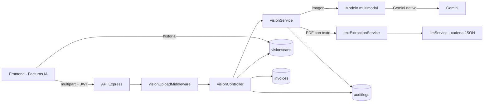

# Semana 3 — Visión por computador: lectura de facturas y recibos

**Asignatura:** Desarrollo de Aplicaciones Empresariales
**Programa:** Tecnología en Desarrollo de Sistemas Informáticos
**Proyecto:** Sistema Inteligente de Gestión y Análisis Documental con IA
**Integrante:** Emmanuel Pinto Plata
**Fecha:** noviembre de 2026

---

## 1. Objetivo y alcance

En la Semana 1 se eligió como caso de visión la **lectura de facturas y
recibos**. En la Semana 3 se implementó el módulo completo:

1. Carga de una imagen (JPG, PNG, WEBP) o PDF de una factura.
2. Extracción estructurada con un modelo multimodal: proveedor, NIT, fecha,
   número de factura, ítems, subtotal, impuestos, total y moneda.
3. Cálculo de una **confianza** global y de los campos dudosos.
4. Regla de decisión: si la confianza es mayor o igual a `0.85`, el gasto se
   guarda automáticamente; si es menor, el usuario debe revisar y confirmar.
5. Error claro cuando la imagen no es legible o no corresponde a una factura.
6. Página de frontend **Facturas IA** con vista previa, edición de los datos y
   resaltado de los campos de baja confianza.
7. Auditoría de cada intento de lectura y de cada confirmación.

El alcance es un proceso real de la empresa: registrar los gastos de compras
(facturas de proveedores) sin digitar manualmente los datos.

---

## 2. Resultado de la semana

| Requisito de la guía | Estado | Evidencia |
|---|---|---|
| Captura de imágenes o PDF | Cumplido | `POST /api/vision/scan`, `visionUploadMiddleware.js` |
| Procesamiento con IA | Cumplido | `visionService.extractInvoice` (multimodal) |
| Extracción de proveedor, NIT, fecha, número, ítems, subtotal, impuestos y total | Cumplido | JSON normalizado en `VisionScan.data` |
| Confianza y decisión automática | Cumplido | `confianza`, `needsReview`, umbral `VISION_MIN_CONFIDENCE=0.85` |
| Revisión y confirmación del usuario | Cumplido | `POST /api/vision/scans/:id/confirm` + formulario editable |
| Error claro si la imagen no es legible | Cumplido | `isUnreadable` → HTTP 422 con mensaje explícito |
| Claves solo en variables de entorno | Cumplido | `backend/.env.example`; `.env` fuera de Git |
| Imágenes de facturas no públicas | Cumplido | `/uploads/vision` responde 403 |
| Pruebas unitarias | Cumplido | `backend/test/visionService.test.js` — 26 pruebas en total |
| Resultados medidos con un proveedor real | Cumplido | Gemini `gemini-3.5-flash-lite`, 3 documentos de prueba |

---

## 3. Arquitectura implementada



### Orden de proveedores

1. **Gemini multimodal** si existe `GEMINI_API_KEY` (proveedor único de visión).
2. Si no hay clave, se devuelve un error claro y no se guarda nada.
3. Para PDF con texto seleccionable se usa la cadena JSON de chat ya existente.
4. Un PDF escaneado (sin texto) devuelve un error que pide subirlo como imagen.

---

## 4. Modelo de datos

### 4.1 `VisionScan` — intento de lectura

| Campo | Tipo | Uso |
|---|---|---|
| `user` | ObjectId | Dueño del intento. |
| `originalName`, `filename`, `path` | String | Archivo original y almacenado. |
| `fileType`, `mimeType`, `size` | — | Metadatos del archivo. |
| `source` | `image` \| `pdf` | Origen del documento. |
| `status` | `processing` \| `review` \| `saved` \| `error` | Estado del intento. |
| `provider`, `model`, `mode` | String | Proveedor y modo (`vision` \| `text`). |
| `data` | Objeto | Datos estructurados normalizados. |
| `confianza` | Number 0–1 | Confianza global. |
| `camposBajaConfianza` | [String] | Campos que el usuario debe revisar. |
| `requiresReview` | Boolean | Resultado de la regla de decisión. |
| `invoice` | ObjectId | Gasto creado (si se guardó). |
| `error` | String | Mensaje cuando la lectura falla. |
| `processedAt`, `reviewedAt` | Date | Marcas de tiempo del proceso. |

### 4.2 `Invoice` — gasto confirmado

Guarda los mismos campos de la factura, más `origin` (`vision` \| `manual`),
`status` (`confirmed` \| `voided`) y la referencia al `VisionScan`. Una lectura
confirmada es **inmutable**: un segundo intento de confirmación responde `409`.
Si se elimina el intento, el gasto confirmado se conserva.

---

## 5. Servicio de visión

`backend/src/services/visionService.js` concentra la lógica:

- **Prompt estricto** que exige un único objeto JSON con la forma acordada.
- **Normalización** de montos colombianos (`$ 1.250.000` → `1250000`,
  `12,50` → `12.5`), fechas (`08/11/2026` → `2026-11-08`) y moneda a mayúsculas.
- **Cálculo de totales** cuando el modelo omite subtotal o total.
- **Confianza** aceptada como `0.92`, `92` o `"92 %"` y acotada a `[0, 1]`.
- **Campos obligatorios** (`proveedor`, `fecha`, `numero_factura`, `total`) que
  faltan se agregan automáticamente a `camposBajaConfianza`.
- **Detección de ilegible** (`isUnreadable`): sin ningún dato útil, o confianza
  casi nula sin total, se responde con un error legible para el usuario.
- **Auditoría** de cada lectura (`vision.factura_leida`) y confirmación
  (`vision.factura_confirmada`) con proveedor, modelo, confianza y duración.

### Límite de tokens (hallazgo real)

En la primera prueba real el proveedor respondió `402` porque, al no enviar
`max_tokens`, reservaba el máximo del modelo (65 535 tokens) y la cuenta solo
podía costear 13 958. Se agregó `VISION_MAX_TOKENS=4096`; tras el ajuste la
lectura funcionó correctamente.

---

## 6. API nueva

Todas las rutas requieren JWT (`protect`).

| Método | Ruta | Uso |
|---|---|---|
| `POST` | `/api/vision/scan` | Sube y procesa una factura (multipart `file`). |
| `GET` | `/api/vision/scans` | Historial del usuario (`?all=true` para admin). |
| `GET` | `/api/vision/scans/:id` | Detalle de una lectura. |
| `POST` | `/api/vision/scans/:id/confirm` | Revisa, corrige y confirma el gasto. |
| `DELETE` | `/api/vision/scans/:id` | Elimina el intento y su archivo. |
| `GET` | `/api/vision/invoices` | Gastos confirmados. |
| `GET` | `/api/health` | Reporta también los proveedores de visión. |

Respuesta de `POST /api/vision/scan`:

```json
{
  "scan": { "status": "saved", "confianza": 0.98, "...": "..." },
  "invoice": { "total": 548828, "...": "..." },
  "requiresReview": false,
  "threshold": 0.85
}
```

Si la lectura falla, responde `422` con `{ message, scan }` y el `scan` queda en
estado `error` para que el usuario vea qué pasó.

---

## 7. Frontend — Facturas IA

La página `frontend/src/pages/VisionPage.jsx` (ruta `/vision`, menú
**Facturas IA**) incluye:

- Zona de carga con arrastrar y soltar, vista previa de la imagen y límite de
  10 MB (JPG, PNG, WEBP, PDF).
- Panel de resultados con barra de confianza animada y el proveedor/modelo usado.
- Formulario editable con los campos extraídos; los campos de baja confianza se
  resaltan en ámbar.
- Tabla de ítems editable con total por línea.
- Botones **Confirmar y guardar** y **Descartar lectura**.
- Aviso verde cuando la factura se guardó automáticamente.
- Historial de lecturas recientes con estado, confianza y total.
- Estilos coherentes con el rediseño: tarjetas blancas, acento índigo para las
  acciones de IA, tipografía Plus Jakarta Sans / Inter / JetBrains Mono.

---

## 8. Seguridad y protección de datos

- Las claves viven solo en `backend/.env` (nunca en Git); `.env.example`
  documenta las variables.
- Cada lectura y cada gasto quedan asociados al usuario autenticado. Un usuario
  no puede ver ni modificar lecturas de otro; el admin puede listar todo con
  `?all=true`.
- Las imágenes de facturas se guardan en `backend/uploads/vision`, pero esa ruta
  responde **403** y no se sirve como estático.
- La imagen se envía al proveedor solo porque el usuario la sube de forma
  explícita; no se envían imágenes de otros documentos sin autorización.
- Borrar un intento no borra el gasto ya confirmado, para no perder el registro
  contable.

---

## 9. Pruebas y evidencias

### 9.1 Pruebas unitarias

`cd backend && npm test` → **26 pruebas aprobadas** (0 fallos). Las 8 pruebas de
visión cubren:

| Prueba | Qué valida |
|---|---|
| `parseAmount` | Montos colombianos, símbolos y separadores. |
| `normalizeDate` | ISO y `dd/mm/aaaa`. |
| `normalizeConfidence` | `0.92`, `92` y `"92 %"`. |
| `normalizeInvoiceData` | Estructura completa de una factura. |
| `normalizeInvoiceData` | Cálculo de totales omitidos. |
| `normalizeInvoiceData` | Campos obligatorios faltantes. |
| `needsReview` | Umbral de confianza y campos dudosos. |
| `isUnreadable` | Imagen sin datos útiles. |

### 9.2 Prueba real con Gemini (modelo multimodal)

Los documentos de prueba se generaron como imágenes PNG de una factura
colombiana y se procesaron con `gemini-3.5-flash-lite`. Resultados medidos:

| Documento | Resultado | Confianza | Decisión |
|---|---|---|---|
| Factura completa | Datos correctos (5 ítems, total $548.828) | **0.98** | Guardada automáticamente |
| Recibo incompleto | Proveedor y fecha; sin NIT, número ni totales | **0.50** | Enviado a revisión (6 campos marcados) |
| Imagen ilegible | Sin datos útiles | 0.00 | HTTP 422 con mensaje claro |

Salida real de la factura completa:

```json
{
  "data": {
    "proveedor": "FERRETERIA LA TUERCA S.A.S.",
    "nit": "900.123.456-7",
    "fecha": "2026-11-08",
    "numero_factura": "FV-2026-0042",
    "items": [
      { "descripcion": "Tornillo autoperforante 1 pulgada", "cantidad": 50, "valor_unitario": 450 },
      { "descripcion": "Taladro percutor 650W", "cantidad": 1, "valor_unitario": 289000 },
      { "descripcion": "Juego de brocas 10 piezas", "cantidad": 2, "valor_unitario": 38500 },
      { "descripcion": "Cinta metrica 5m", "cantidad": 3, "valor_unitario": 12900 },
      { "descripcion": "Guantes de seguridad", "cantidad": 4, "valor_unitario": 8500 }
    ],
    "subtotal": 461200,
    "impuestos": 87628,
    "total": 548828,
    "moneda": "COP"
  },
  "confianza": 0.98,
  "camposBajaConfianza": [],
  "provider": "gemini",
  "model": "gemini-3.5-flash-lite",
  "mode": "vision"
}
```

Además se verificaron chat (`{"ok":true}`), embeddings
(`gemini-embedding-001`, **1536 dimensiones**) y búsqueda vectorial real
(`mode=vector`, similitud `0.8799`) sobre el índice de Atlas, que también usa
1536 dimensiones. Los 43 fragmentos quedaron reindexados sin recrear el índice.

### 9.3 Flujo de revisión y confirmación (API real)

| Paso | Resultado medido |
|---|---|
| Escanear recibo incompleto | `status=review`, `requiresReview=true`, `invoice=null` |
| Confirmar con correcciones | `status=saved`, gasto con total `35700` |
| Confirmar de nuevo | **HTTP 409** (lectura ya guardada) |
| Eliminar el intento | Gasto conservado en `/api/vision/invoices` |
| Listar historial | `threshold=0.85` |

### 9.4 Verificación del frontend

Con el frontend servido en local y un navegador headless (Microsoft Edge, CDP) se
verificó la página `/vision`:

| Comprobación | 1440 px | 390 px |
|---|---|---|
| Desbordamiento horizontal | No | No |
| Consola del navegador | Sin errores | Sin errores |
| Columnas del panel | 2 columnas | 1 columna |
| Formulario e ítems | Correctos | Reorganizados en 2 columnas |
| Carga real desde la UI | Guardado automático, 98 %, aviso verde | — |
| Ruta de revisión | Campos resaltados y aviso "Revisa: ..." | — |

---

## 10. Cómo ejecutar y demostrar

```bash
# Backend
cd backend
npm install
npm test
npm start            # http://localhost:5000

# Frontend
cd frontend
npm install
npm run dev          # http://localhost:5173
```

Variables mínimas para visión en `backend/.env`:

```env
GEMINI_API_KEY=tu_clave
GEMINI_VISION_MODEL=gemini-3.5-flash-lite
VISION_MIN_CONFIDENCE=0.85
VISION_TIMEOUT_MS=90000
VISION_MAX_RETRIES=0
VISION_MAX_TOKENS=4096
```

Demostración en clase:

1. Abrir **Facturas IA** y arrastrar una factura legible.
2. Mostrar la confianza (p. ej. 98 %) y el aviso de guardado automático.
3. Subir un recibo incompleto y mostrar los campos resaltados y la edición manual.
4. Confirmar el gasto y mostrar el historial.
5. Subir una imagen ilegible y mostrar el error claro.

---

## 11. Pendientes y recomendaciones

- ~~Ejecutar la prueba en vivo con una clave **Gemini** propia para no depender
  de un proveedor externo.~~ Cumplido: chat, visión y embeddings verificados con
  Gemini, y fragmentos reindexados a 1536 dimensiones.
- Rotar la clave `AQ.` de Gemini que se compartió en el chat: debe considerarse
  expuesta. La clave nueva debe existir solo en las variables de entorno.
- Replicar en Render las variables `GEMINI_*` y `EMBEDDINGS_PROVIDER=gemini`
  (`GEMINI_EMBEDDING_DIMENSIONS=1536`); el `.env` local no se despliega.
- Para la Semana 4: conectar el gasto confirmado con el motor de automatización
  (notificación y conciliación) y ejecutar la batería de 20 imágenes.

---

## 12. Criterios de aceptación de la Semana 3

| Criterio | Cumple |
|---|---|
| Lee facturas y recibos desde imagen o PDF | Sí |
| Devuelve datos estructurados completos | Sí |
| Decide automáticamente según la confianza | Sí (`0.85`) |
| Permite revisar y confirmar | Sí |
| Informa con claridad cuando no puede leer | Sí (HTTP 422) |
| Protege claves e imágenes | Sí |
| Tiene pruebas y evidencias medibles | Sí (26 pruebas + 3 casos reales) |

---

## 13. Archivos principales

### Backend

| Archivo | Función |
|---|---|
| `src/services/visionService.js` | Extracción, normalización, confianza y auditoría. |
| `src/controllers/visionController.js` | Escanear, listar, confirmar y eliminar. |
| `src/models/VisionScan.js` | Intento de lectura. |
| `src/models/Invoice.js` | Gasto confirmado. |
| `src/middleware/visionUploadMiddleware.js` | Validación y almacenamiento del archivo. |
| `src/routes/visionRoutes.js` | Rutas `/api/vision`. |
| `src/config/env.js` | Umbral, timeout, reintentos y tope de tokens. |
| `test/visionService.test.js` | Pruebas unitarias de visión. |

### Frontend

| Archivo | Función |
|---|---|
| `src/pages/VisionPage.jsx` | Página de carga, revisión e historial. |
| `src/components/Icons.jsx` | Íconos `ScanIcon` y `ReceiptIcon`. |
| `src/components/Sidebar.jsx` | Entrada de menú **Facturas IA**. |
| `src/components/AnimatedNumber.jsx` | Contador animado de la confianza. |
| `src/index.css` | Estilos `.vision-*`. |
| `src/App.jsx` | Ruta `/vision`. |

### Documentación

| Archivo | Función |
|---|---|
| `Semana 3 - Visión/Implementación y evidencias - Semana 3.md` | Este documento. |
| `backend/.env.example` | Variables de visión documentadas. |
